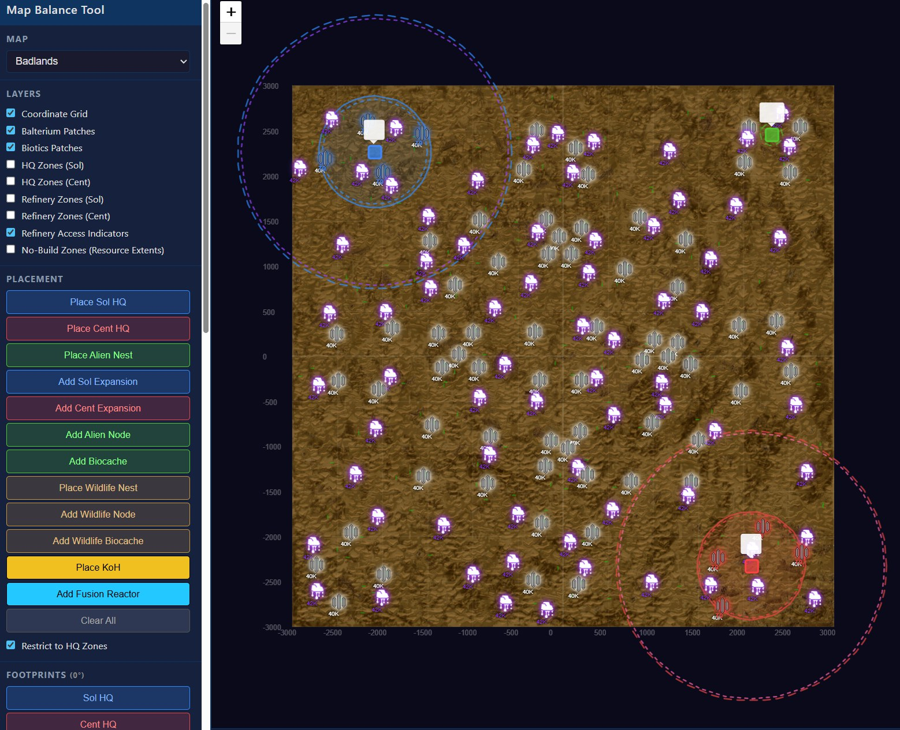

# Si_MapBalance

A server-side [Silica](https://store.steampowered.com/app/504900/Silica/) mod that overrides map spawn positions and resource distribution using layout configurations.

> 🛠️ **Author layouts in the browser** with the interactive **[Map Balance Tool](https://drmuck.github.io/Silica-MapBalanceTool/)** — no install required, runs entirely client-side. Pick spawn positions on the map image, place resource patches, tag layouts by game mode, then export ready-to-deploy JSONs straight into `UserData/cfg/Spawns/`. Tool source: [github.com/DrMuck/Silica-MapBalanceTool](https://github.com/DrMuck/Silica-MapBalanceTool).



*Screenshot from the [interactive tool](https://drmuck.github.io/Silica-MapBalanceTool/): Badlands map with Sol (blue), Centauri (red), and Alien (green) bases placed; dashed rings show each faction's **build radius**. The build radius value can be tuned per-faction in [Si_UnitBalance](https://github.com/DrMuck/Silica-UnitBalance) (via the `build_radius` parameter under each HQ entry in `Si_UnitBalance_Config.json`, or live through the `!b` editor).*

Maps without a configuration run fully vanilla — no changes to spawns or resources.

## Features

- **Custom spawn positions** for Sol, Centauri, and Alien per map
- **Resource control**: per-type amounts (Balterium, Biotics), per-patch overrides, patch removal
- **Game mode filtering**: layouts are tagged as HvH, HvA, or HvHvA — the mod auto-detects the active game mode and only picks from matching configs
- **Multiple layouts per map**: place several JSON files in a map folder and the mod picks one randomly each round
- **Sol/Cent swap**: in HvH and HvHvA, spawn positions are randomly swapped (50% chance) for extra variation; a layout can turn it off with `"swap_spawns": false`
- **2v1 layouts** (3.4.0): when [Si_VersusVote](#2v1-rounds-si_versusvote) plays a voted HvHvA as a 2v1 (Sol + Centauri allied against the Aliens), only layouts flagged `"2v1": true` in `game_modes` are used; normal HvHvA rounds never use them
- **Layout pins** (3.5.0): admins can [pin one layout per map](#pinning-a-layout-admins) (`!layout pin`), e.g. for show matches; persisted, with a master switch
- **Allchat announcement**: the selected layout name is shown to all players at game start
- **Per-faction settings**: build radius and chain range per faction

## How It Works

### 1. Create layouts with the Map Balance Tool

Open **[Map Balance Tool](https://drmuck.github.io/Silica-MapBalanceTool/)** in your browser. It's a single-page web app — no install, no account, all editing happens locally — that lets you:

- Pick a Silica map background image
- Click-place HQ / Nest spawn positions for each faction
- Define resource patches with per-type amounts (Balterium / Biotics)
- Remove specific in-map resource patches
- Tag the layout with game-mode flags (`hvh`, `hva`, `hvhva`, optionally `4way`, or `2v1` for allied-humans-vs-Aliens rounds)
- Set per-faction settings (build radius, chain range, etc.)
- Export ready-to-deploy JSON files

Tool source: [github.com/DrMuck/Silica-MapBalanceTool](https://github.com/DrMuck/Silica-MapBalanceTool).

Output filenames the tool typically produces:

```
layout_Badlands_HvH.json
layout_Badlands 3way.json
layout_CrimsonPeak_3way_north.json
```

Each JSON contains:
- **Spawn positions** for each faction
- **Resource amounts** (uniform per type + per-patch overrides)
- **Removed patches** (resource areas to disable)
- **Game mode flags** (`hvh`, `hva`, `hvhva`)
- **Per-faction settings** (build radius, chain range)

### 2. Deploy to the server

Copy the JSON files into the server's `UserData/cfg/Spawns/` directory, organized by map name:

```
Silica Dedicated Server/
  UserData/
    Spawns/
      Badlands/
        layout_Badlands_HvH.json
        layout_Badlands 3way.json
        layout_Badlands HvA_Middle_bottom_Top.json
      CrimsonPeak/
        layout_CrimsonPeak_3way_north.json
        layout_CrimsonPeak_HvH_diagonal_1.json
      ...
```

The folder name must match the map name exactly (e.g., `Badlands`, `CrimsonPeak`, `NorthPolarCap`).

### 3. The mod handles the rest

When a round starts:
1. The mod detects the **game mode** (HvH / HvA / HvHvA) from active teams, and asks Si_VersusVote (if loaded) whether this HvHvA round is a **2v1**
2. It scans `UserData/cfg/Spawns/{MapName}/` for JSON files matching that game mode (2v1 round: only `"2v1": true` layouts; normal HvHvA round: `"2v1"` layouts excluded)
3. One layout is **picked randomly**
4. In HvH and HvHvA, Sol and Cent positions may be **swapped** (50% chance), unless the layout sets `"swap_spawns": false`
5. HQ spawn positions and resource areas are overridden accordingly
6. The selected layout name is **announced in allchat** (with `[2v1: Sol + Centauri vs Aliens]` in a 2v1 round)

## Installation

1. Requires [MelonLoader](https://github.com/LavaGang/MelonLoader) on the dedicated server
2. Copy `Si_MapBalance.dll` to the server's `Mods/` folder
3. Place layout JSONs in `UserData/cfg/Spawns/{MapName}/`
4. Restart the server

## JSON Format

Layout files exported from the Map Balance Tool look like this:

```json
{
  "map": "Badlands",
  "spawns": {
    "Sol": [{ "x": -2160, "z": -120, "isSpawn": true, "isBiocache": false }],
    "Cent": [{ "x": 2250, "z": 2160, "isSpawn": true, "isBiocache": false }],
    "Alien": [{ "x": -675, "z": -2475, "isSpawn": true, "isBiocache": false }]
  },
  "resources": {
    "balterium_amount": 40000,
    "biotics_amount": 50000,
    "removed_patches": [7, 13, 19],
    "patch_overrides": { "2": 60000, "10": 60000 }
  },
  "settings": {
    "solBuildRadius": 620,
    "centBuildRadius": 600,
    "solChainRange": 1520,
    "centChainRange": 1500
  },
  "game_modes": {
    "hvh": true,
    "hva": false,
    "hvhva": false
  },
  "swap_spawns": true
}
```

| Field | Description |
|-------|-------------|
| `spawns` | Faction HQ positions (world X/Z coordinates) |
| `resources.balterium_amount` | Uniform Balterium amount per patch |
| `resources.biotics_amount` | Uniform Biotics amount per patch |
| `resources.removed_patches` | Patch indices to disable (no resources) |
| `resources.patch_overrides` | Per-patch amount overrides (key = patch index) |
| `settings.*BuildRadius` | Build radius per faction |
| `settings.*ChainRange` | Chain range per faction |
| `game_modes` | Which game modes this layout is valid for (`hvh`, `hva`, `hvhva`, `4way`) |
| `game_modes."2v1"` | `true` = 2v1 layout (3.4.0): used only in a Si_VersusVote 2v1 round, never in a normal HvHvA round; absent or `false` = normal layout |
| `swap_spawns` | `false` = never swap Sol and Cent positions for this layout; absent or `true` = 50 % swap in HvH / HvHvA |
| `spawns.<Faction>[0].rot` | 3.6.0, optional: yaw of that base in degrees (tool: 0/90/180/270). Absent = the nearest vanilla start point's rotation (as before). It belongs to the position: after a Sol/Cent swap the other HQ uses it, so in swappable layouts it must suit both HQs. Older builds ignore it |

## 2v1 rounds (Si_VersusVote)

Si_VersusVote can play a voted HvHvA on some maps (e.g. IndustrialQuarter) as a **2v1**: the vanilla 3-team setup, but Sol and Centauri are allied for the whole round against the Aliens. A symmetric 3-way triangle is the wrong layout for that, so such rounds get their own layouts: both human HQs on one side as a bloc, the Nest opposite, resources balanced for two allied humans against one alien team.

**Flag a layout** in the Map Balance Tool with the Game Modes checkbox *2v1 (allied humans vs Aliens)*, or by hand:

```json
"game_modes": { "hvh": false, "hva": false, "hvhva": false, "4way": false, "2v1": true }
```

**Selection rule**

| Round | Candidate layouts |
|-------|-------------------|
| 2v1 (Si_VersusVote `TwoVsOneActive`, 3 active teams) | layouts with `"2v1": true` (their `hvhva` value does not matter). None on the map: Warning once per map, then the normal HvHvA pool |
| normal HvHvA | layouts with `"hvhva": true` **and not** `"2v1": true` |
| HvH / HvA / 4way | unchanged (their own flag) |

Log lines (MelonLoader, `[Map_Balance]`): `2v1 round on IndustrialQuarter: 3 candidate layout(s) [a, b, c] — picked b`, `Layout pick: b (mode hvhva/2v1, by prefix)`; in a normal HvHvA round `..., 1 2v1 layout(s) excluded (not a 2v1 round)`. The allchat announcement ends with `[2v1: Sol + Centauri vs Aliens]` (or `[2v1 round, no 2v1 layout: 3-way layout]` on the fallback). The `map_layout` game-log line is unchanged.

**How the 2v1 state is read.** No compile-time reference: `VersusVoteBridge` looks up `Si_VersusVote.VersusApi` by reflection (`ApiVersion >= 1`, static `TwoVsOneActive`). Without Si_VersusVote the mod behaves exactly as 3.3.2 (2v1 layouts are then never picked; normal HvHvA rounds still exclude them).

**Timing.** Si_VersusVote sets the flag in its `HarmonyPriority.First` prefix on `MP_Strategy.SetTeamVersusMode` (cleared on `MP_Strategy.Restart`). Si_MapBalance never picks before that call has returned: the pick is made in the `ResourceArea.DistributeAllResources` prefix, which vanilla calls right after `SetTeamVersusMode` at the vote end (`MP_Strategy.cs` 1.0.15 ~2590), or, if the game skips that call (headless path), in the `MP_Strategy.SpawnBaseStructures` prefix, which runs later on the first team join (`QueueCoopSpawnBaseStructures`) and is the method that places the HQs/Nest. `SpawnBaseStructures` re-checks the flag; if it changed after the first pick (HQs are still unplaced at that point), it re-picks and re-applies the resources, as for a mode mismatch.

**Older mod builds** ignore the `"2v1"` key and use the other `game_modes` flags, which is why the tool unticks HvH / HvA / HvHvA / 4-Way when the 2v1 box is ticked.

## Pinning a layout (admins)

For show matches or to try one specific JSON, an admin can **pin** a layout per map instead of the random pick (3.5.0). The layout is chosen once per round, so a pin (or unpin) takes effect at the **next round start**; the running round keeps its layout.

| Command | Effect |
|---------|--------|
| `!layout` (or `!layout status`) | Current map, this round's layout (`PINNED` or `random`, with mode), the pin for this map, the master switch, all pins |
| `!layout list [map]` | Numbered layout files of the current (or named) map with their mode tags (`hvh, hva`, `hvhva, 4way`, `2v1`, `any mode`, `KoH`); the pinned one and this round's one are marked |
| `!layout pin <name or #>` | Pin a layout for the current map |
| `!layout pin <map> <name or #>` | Pin for another map (set it before `!map`) |
| `!layout unpin [map]` / `!layout unpin all` | Remove the pin of the current / named map, or every pin |
| `!layout pinning on` / `off` | Master switch: `off` keeps the pins but ignores them |

Admin power: `Map` (AdminMod). **Name matching** (case-insensitive, `.json` optional): exact file name first, then the list number from `!layout list` (`3` or `#3`; numbers follow the case-insensitive name order), then a unique part of the name. Several hits: the reply lists them and nothing is pinned. A file that does not parse is refused.

**Pins file**: `UserData/cfg/MapBalance/layout_pins.json`, written on every change and re-read when edited by hand:

```json
{
  "pinning": true,
  "pins": {
    "Badlands": "Badlands_hvh_gen_3150m_50bal_110bio_s2106790910-1.json",
    "IndustrialQuarter": "layout_IndustrialQuarter_2v1.json"
  }
}
```

Keys are map names (`UserData/cfg/Spawns/<map>/`), values are file names in that folder. No file = pinning on, no pins. An unreadable file is logged as a Warning and treated as empty (the next change overwrites it).

**When a pin is not used.** At the round's single pick, the pin is used only if pinning is on, the file exists, parses, and supports the round's mode by the same rules as the random pool:

| Round | Pinned layout accepted if |
|-------|---------------------------|
| HvH / HvA / HvHvA / 4way | no `game_modes` (mode-agnostic), or the round's mode is `true`; in a normal HvHvA round never a `"2v1": true` layout |
| 2v1 (Si_VersusVote) | `"2v1": true`; if the map has no 2v1 layout at all, a normal `hvhva` layout too (same as the random fallback) |

Otherwise the round uses the normal random pick: Warning `Layout pin for <map> (<file>) NOT used: <reason> — random pick instead` (once per round), and the allchat line ends with `[pinned layout skipped: <reason>]`. The KoH preference of the random pick does not apply to a pin; a pinned layout with a `koh` block outside KoH mode just gets no tower. The layout's own `swap_spawns` still decides the Sol/Cent swap.

**Logs and announce.** `Layout pick: <name> (PINNED) (mode hvh, by prefix)`; allchat `Map Balance: <name> [PINNED]`. The `map_layout` game-log line (MapReplay) is unchanged.

**Si_ModUI**: the mod exports `ModUIData()` (admin only, Si_MapBalance has no player command, so nothing reaches players): status lines (map, this round's layout, the pin), a *Pinning (master switch)* ON/OFF row, a *Pin layout (this map)* picker with the map's files and their mode tags, *Unpin this map*, *Clear all pins*, *List layouts* and *Status*. `!mapdump` stays as before.

## Base site check and site scan (3.6.0)

A layout can put a base where it does not fit: against a cliff, inside a rock, between buildings, on a
ledge cut off from the rest of the map. Starter units then spawn inside geometry. 3.6.0 tests every
configured base with one **site test** (`SiteTest.cs`) for Sol HQ, Centauri HQ and Alien Nest:

| Test | Definition | Reason code |
|------|------------|-------------|
| on the map | FogOfWar bounds and a terrain tile contain the point (the game's `OutsideMap`) | 1 `offmap` |
| ground (HQs only; for the Nest recorded, not a failure: vanilla spawns Nests where the build rule fails) | the structure's own `ConstructionPreview.GetGroundSlopeClear` (the commander's build rule), replicated to measure the foundation gap; valid while the worst BelowGround point sticks out at most 8 m (`GroundTol`, about the 95th percentile of the vanilla start points) | 2 `ground_terrain` (heightmap alone already fails), 3 `ground_static` (only with rocks/meshes) |
| (on static) | standing on a non-terrain surface more than 4 m above the heightmap: logged, not a failure (Citadel plateaus and IndustrialQuarter platforms are meshes) | (4 `on_static`, unused) |
| no overlap | no static collider (rocks, cliffs, buildings, props, invisible walls; not terrain, not structures or units) penetrates the structure's collision boxes deeper than 3 m (`OverlapDepth`, about the 97th percentile of the vanilla start points) | 5 `overlap` |
| navmesh | at least 2 of 8 probes around the footprint (+12 m) on the main connected component of `Small Vehicle` (HQs) / `Voxel Graph` (Nest) | 6 `navmesh` |

**Runtime warning.** When a round applies a layout, each configured base is tested before it is
spawned (warning only, nothing is moved). One line per bad base, e.g.

```
[Map_Balance] [SITE] BAD BASE map=Citadel layout=layout_Citadel_HVH_HVA_3W_2 team=Sol pos=(870,-960) rot=0 (start point 'StrategyStart_Human_…') reason=overlap blocker='Cliffs/CYN_Cliff_Wall_02_WithTop_48' [Static] (4.8 m deep, 2 boxes) [code …]
[Map_Balance] [SITE] Base site check Citadel layout_Citadel_HVH_HVA_3W_2: 1 of 3 bases flagged (see BAD BASE lines; bases are NOT moved)
```

or `[SITE] Base site check <map> <layout>: all N bases clear`.

**Site scan mode** (for the Map Balance Tool data). Needed once per map and game version (rescan after a map, base structure prefab or navmesh change); every check of a layout afterwards works offline from the tool data (`tools/site_audit.py`). Create `UserData/cfg/MapBalance/site_scan.json`:

```json
{
  "enabled": true,
  "maps": ["Citadel", "IndustrialQuarter", "NarakaCity"],
  "layouts_dir": "C:\\path\\to\\Spawns",
  "grid": true, "layout_check": true, "start_points": true, "starter_audit": false,
  "frame_budget_ms": 40
}
```

Start the server: on every map load the mod waits for the navmesh, scans the map if it is listed and
not done, then loads the next listed map (`NetworkGameServer.LoadLevel`, running game mode). No round
or player is needed. Progress is kept in `UserData/MapBalance/site_scan/state.json` (delete it to
rescan); set `"enabled": false` (or delete the file) when done. Output in `UserData/MapBalance/site_scan/`:

| File | Content |
|------|---------|
| `site_scan_<Map>_<ts>.txt` | header + CSV per 15 m cell of the hq_scan grid: surface y, site code of Sol/Cent/Alien at yaw 0/90/180/270, open-ground bits (vehicle / alien probe) |
| `site_startpoints_<Map>_<ts>.csv` | every vanilla start point at its own yaw and the 4 grid yaws (calibration; `preprocess.py` copies the positions and yaws into the tool's site meta so the yaw the mod uses resolves offline) |
| `site_layouts_<Map>_<ts>.csv` | every base of every layout in `layouts_dir/<Map>/` (subfolders too): the yaw the mod uses today and the 4 grid yaws, reason, blocking collider, gap, depth |
| server log `[STARTER] audit … extra …` | optional (`starter_audit`, off by default and not needed): Si_StarterUnits' dry run at the same bases (test points written to `cfg/StarterUnits/audit/<Map>/` and removed again) |

Optional keys: `grid_step` (15), `output_dir`, `vehicle_ref` / `alien_ref` (open-ground probe units),
`settle_seconds` (8), and the calibration overrides `ground_tol_m`, `overlap_depth_m`,
`on_static_max_m`, `on_static_fails` (the runtime check always uses the built-in values). Cost (measured 2026-11-12, no players):
3-10 minutes per 1000-2048 m map, 13-17 for IndustrialQuarter and the 3000 m maps, 2 h 05 for all 13. The tool converts the files with
`python preprocess.py --sites` (format: Si_MapBalanceTool `docs/SITE_SCAN.md`).

## Build

```bash
cd Si_MapBalance
dotnet build -c Release
```

Output: `bin/Release/netstandard2.1/Si_MapBalance.dll`

Requires game DLLs in `include/netstandard2.1/` (not included — copy from `Silica_Data/Managed/`).
Since 3.6.0 also `AstarPathfindingProject.dll`, `PackageTools.dll` and `Drawing.dll` (the site test
queries the navmesh); the 0.9.47 copies work for both Steam branches.
